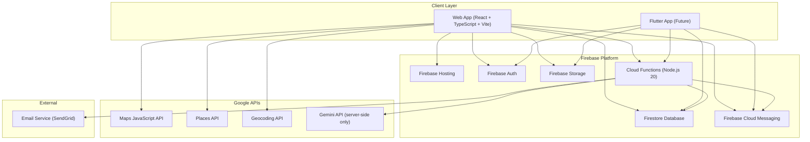
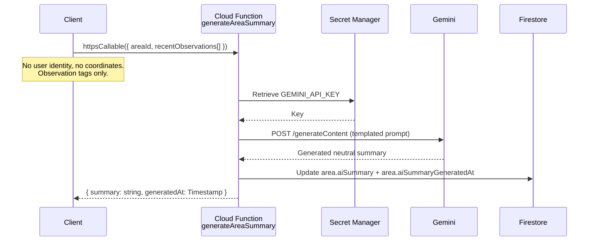

# Awarely — System Architecture

**Version:** 1.0.0  
**Status:** Design Phase — Academic Prototype  
**Date:** October 2026  
**Tagline:** *"Safety, When It Matters."*

---

## Table of Contents

1. [Guiding Principles](#guiding-principles)
2. [System Overview](#system-overview)
3. [Frontend Architecture](#frontend-architecture)
4. [Backend Architecture](#backend-architecture)
5. [Firebase Architecture](#firebase-architecture)
6. [Authentication Architecture](#authentication-architecture)
7. [Google Maps Integration](#google-maps-integration)
8. [Gemini AI Integration](#gemini-ai-integration)
9. [Notification Architecture](#notification-architecture)
10. [Area Resolution Architecture](#area-resolution-architecture)
11. [Safety Scoring Architecture](#safety-scoring-architecture)
12. [Trusted Safety Circle Architecture](#trusted-safety-circle-architecture)
13. [Developer Tools Architecture](#developer-tools-architecture)
14. [Admin Architecture](#admin-architecture)
15. [Security Boundaries](#security-boundaries)

---

## Guiding Principles

These principles govern every architectural decision in Awarely. They are non-negotiable constraints, not design preferences.

| Principle | Mandate |
|---|---|
| **Privacy by Design** | Awarely never stores precise user coordinates, route history, or movement patterns. Location is used ephemerally and client-side only for area resolution. |
| **Community Perception, Not Objective Truth** | All safety data is community-reported perception. The system must never present an area as objectively safe or dangerous. |
| **Area-Wise, Not Point-Wise** | The smallest unit of safety awareness is a defined neighborhood area. No street-level, route-level, or intersection-level granularity. |
| **No Continuous Tracking** | Users are never passively tracked. Location is queried discretely when the user explicitly opens the map or initiates a check-in. |
| **Gemini Only Server-Side** | Gemini API calls are always made through Firebase Cloud Functions. The API key is never exposed to the client. |
| **Flutter-Compatible Data Model** | All Firestore schema decisions must be compatible with a future Flutter application consuming the same backend without schema migration. |
| **Prototype-to-Production Continuity** | Architecture must be clean enough to ship as an academic prototype but structured to evolve into a real product without a ground-up rewrite. |

---

## System Overview



---

## Frontend Architecture

### Stack

| Concern | Technology | Rationale |
|---|---|---|
| Language | TypeScript | Type safety across all layers; essential for complex Firestore data models |
| Framework | React 19 | Concurrent features, ecosystem breadth |
| Build Tool | Vite 6 | Fast HMR, native ESM, small config overhead |
| Styling | Tailwind CSS 4 | Utility-first, design system coherence |
| Animation | Framer Motion 11 | Declarative motion primitives, gesture support for mobile |
| Icons | Lucide React | Consistent, lightweight, tree-shakeable |
| State | React Context + useState/useReducer | Sufficient for prototype scope |
| Firebase | Firebase Web SDK v12 | First-party, tree-shakeable modular imports |
| Maps | `@vis.gl/react-google-maps` | Official Google-backed React wrapper |
| Router | React Router v7 | Nested routes, type-safe routing |

### Project Structure

```
src/
├── components/
│   ├── auth/
│   │   ├── LoginScreen.tsx
│   │   ├── OnboardingModal.tsx
│   │   └── GuestBanner.tsx
│   ├── map/
│   │   ├── AwarelyMap.tsx
│   │   ├── AreaPolygon.tsx
│   │   ├── UserLocationDot.tsx
│   │   └── MapLegend.tsx
│   ├── awareness/
│   │   ├── AreaAlertSheet.tsx
│   │   ├── AreaContextCard.tsx
│   │   └── ConfidenceIndicator.tsx
│   ├── report/
│   │   ├── FeedbackModal.tsx
│   │   ├── ObservationChips.tsx
│   │   └── PhotoPicker.tsx
│   ├── contacts/
│   │   ├── TrustedCircleModal.tsx
│   │   └── ContactCard.tsx
│   ├── profile/
│   │   └── ProfileModal.tsx
│   ├── ui/
│   │   ├── BottomSheet.tsx
│   │   ├── Modal.tsx
│   │   ├── Spinner.tsx
│   │   └── ErrorBoundary.tsx
│   └── dev/
│       └── DevSimulator.tsx   (rendered only in import.meta.env.DEV)
├── hooks/
│   ├── useAreaResolution.ts   (coarse area lookup by coords)
│   ├── useAreaData.ts         (Firestore real-time subscription)
│   ├── useAuth.ts             (Firebase Auth state)
│   ├── useDiscreteLocation.ts (single, user-initiated location query)
│   └── useNotifications.ts    (FCM token + permission)
├── lib/
│   ├── firebase.ts            (Firebase app initialization)
│   ├── firestore.ts           (typed Firestore helpers)
│   ├── auth.ts                (auth methods)
│   └── functions.ts           (httpsCallable wrappers)
├── pages/
│   ├── App.tsx
│   ├── MapPage.tsx
│   └── NotFoundPage.tsx
├── types/
│   ├── area.ts
│   ├── report.ts
│   ├── user.ts
│   └── notification.ts
├── utils/
│   ├── freshness.ts           (human-readable time delta)
│   ├── confidence.ts          (confidence label calculation)
│   └── coordinates.ts         (haversine, bbox helpers)
├── constants/
│   └── observationTags.ts
└── main.tsx
```

### Environment Variables (Frontend)

```env
# .env.local (never committed)
VITE_FIREBASE_API_KEY=
VITE_FIREBASE_AUTH_DOMAIN=
VITE_FIREBASE_PROJECT_ID=
VITE_FIREBASE_STORAGE_BUCKET=
VITE_FIREBASE_MESSAGING_SENDER_ID=
VITE_FIREBASE_APP_ID=
VITE_GOOGLE_MAPS_API_KEY=
VITE_APP_ENV=development
```

> **Note:** Firebase client config values are not secrets. They are restricted by Firestore Security Rules, Firebase Auth, and HTTP referrer/domain restrictions on each API key. The Gemini API key is NEVER a frontend environment variable.

### Routing

```
/        → MapPage (authenticated or guest)
/login   → LoginScreen
/onboard → OnboardingModal
*        → NotFoundPage
```

---

## Backend Architecture

Awarely uses a **serverless Firebase backend**. There is no dedicated application server. All server-side logic runs in **Firebase Cloud Functions**.

### Cloud Functions Directory

```
functions/
├── src/
│   ├── index.ts
│   ├── gemini/
│   │   └── generateAreaSummary.ts   (HTTPS Callable)
│   ├── reports/
│   │   ├── onReportCreated.ts       (Firestore trigger)
│   │   └── validateReport.ts        (HTTPS Callable)
│   ├── notifications/
│   │   ├── sendCircleAlert.ts       (HTTPS Callable)
│   │   └── sendFCMNotification.ts   (internal helper)
│   ├── areas/
│   │   └── resolveArea.ts           (HTTPS Callable)
│   └── admin/
│       └── recomputeAreaScore.ts    (Scheduled — nightly)
├── package.json
└── tsconfig.json
```

### Function Registry

| Function | Type | Trigger | Description |
|---|---|---|---|
| `generateAreaSummary` | HTTPS Callable | Frontend invocation | Sends observation data to Gemini; returns a neutral summary. Gemini API key in Secret Manager. |
| `onReportCreated` | Firestore Trigger | `reports/{reportId}` create | Updates area `reportCount`, `latestReportAt`, queues score recomputation. |
| `validateReport` | HTTPS Callable | Frontend before submission | Rate limiting (max 3 reports/user/day per area), payload validation. |
| `sendCircleAlert` | HTTPS Callable | User-triggered | Emails all trusted contacts. Rate-limited at 3 alerts/user/24h. |
| `sendFCMNotification` | Internal | Called by other functions | Dispatches FCM push notification to a token or topic. |
| `resolveArea` | HTTPS Callable | Frontend map interaction | Takes coarse coordinates; returns areaId via Geocoding + Firestore polygon lookup. |
| `recomputeAreaScore` | Scheduled | Nightly cron (`0 2 * * *`) | Recalculates all area awareness metrics and confidence scores. |

### Secret Management

All server-side secrets are stored in **Google Cloud Secret Manager**:

```
GEMINI_API_KEY        → generateAreaSummary
SENDGRID_API_KEY      → sendCircleAlert
MAPS_SERVER_API_KEY   → resolveArea (server-side Geocoding)
```

---

## Firebase Architecture

### Project Structure

```
Firebase Project: awarely-safety-when-it-matters
├── Authentication
│   ├── Google Sign-In Provider
│   ├── Email/Password Provider
│   └── Anonymous Provider (Guest)
├── Cloud Firestore (Native Mode, nam5 multi-region)
├── Firebase Storage
├── Cloud Functions (us-central1, Node.js 20)
├── Firebase Hosting
└── Firebase Cloud Messaging
```

### Hosting Configuration

```json
{
  "hosting": {
    "public": "dist",
    "rewrites": [{ "source": "**", "destination": "/index.html" }],
    "headers": [
      {
        "source": "**",
        "headers": [
          { "key": "X-Content-Type-Options", "value": "nosniff" },
          { "key": "X-Frame-Options", "value": "DENY" },
          { "key": "Referrer-Policy", "value": "strict-origin-when-cross-origin" }
        ]
      },
      {
        "source": "/assets/**",
        "headers": [{ "key": "Cache-Control", "value": "public, max-age=31536000, immutable" }]
      }
    ]
  }
}
```

---

## Authentication Architecture

### Auth Flow

```
User opens app
    │
    ├── Valid Firebase session? ── Yes ──► MapPage
    │
    └── No ──► LoginScreen
                  ├── Continue as Guest ──► Anonymous Auth ──► MapPage (view-only)
                  ├── Sign in with Google ──► GoogleAuthProvider Popup
                  ├── Sign in with Email ──► EmailAuthProvider
                  └── Create Account ──► EmailAuthProvider.createUser
```

### Session Persistence

- `onAuthStateChanged` initialized at app root in `AuthContext`.
- Auth state persisted across page refreshes via Firebase session storage.
- Guest accounts can be upgraded (Firebase Anonymous Auth → `linkWithCredential`).

### Permission Levels

| Capability | Guest (Anonymous) | Authenticated | Admin |
|---|---|---|---|
| View area awareness data | ✅ | ✅ | ✅ |
| Submit community reports | ❌ | ✅ | ✅ |
| Manage trusted contacts | ❌ | ✅ | ✅ |
| Trigger circle alerts | ❌ | ✅ | ✅ |
| Manage area definitions | ❌ | ❌ | ✅ |

---

## Google Maps Integration

### APIs Required

| API | Usage | Key Type |
|---|---|---|
| Maps JavaScript API | Map tiles, area overlays, user dot | HTTP referrer restricted (frontend) |
| Places API | Place-name search (future) | HTTP referrer restricted (frontend) |
| Geocoding API | Coordinate → area resolution | **Server-side only** — IP restricted |

### Map Component Architecture

```tsx
<APIProvider apiKey={import.meta.env.VITE_GOOGLE_MAPS_API_KEY}>
  <Map
    mapId="awarely-main-map"       // Cloud-styled: POI labels off
    defaultCenter={userCoarseLocation}
    defaultZoom={14}
    minZoom={12}
    maxZoom={16}
    gestureHandling="greedy"
    disableDefaultUI={true}
  >
    {areas.map(area => (
      <AreaPolygon key={area.id} area={area} />
    ))}
    <UserLocationDot position={userCoarsePosition} />
  </Map>
</APIProvider>
```

### Visualization Rules

- Areas rendered as translucent **Polygon overlays** from Firestore boundary coordinates.
- Color represents **community consensus level**, not a safety verdict:
  - `teal-400/20%` = "Active Community Area" (`awarenessLevel: "active"`)
  - `amber-400/20%` = "Mixed Conditions Reported" (`awarenessLevel: "mixed"`)
  - `slate-400/20%` = "Quiet — Few Recent Reports" (`awarenessLevel: "quiet"`)
  - `slate-200/10%` = "Limited Data Available" (`awarenessLevel: "unknown"`)
- User rendered as a **large imprecise blue circle** (~150m radius), never a precise pin.
- Zoom clamped between **12–16**. Street-level zoom is disabled.

> **Prohibited:** Red/green coloring and words "safe", "dangerous", "risk", "danger" in any area-facing UI.

---

## Gemini AI Integration

### Constraint

> **The Gemini API key never exists in client-side code, browser environment variables, or HTTP responses visible to clients.**

### Integration Flow



### Prompt Template

```
SYSTEM: You are a neutral, factual safety awareness assistant.

RULES:
- Do NOT say an area is safe or unsafe.
- Do NOT predict crime or danger.
- Do NOT use fear-inducing language.
- DO describe observed conditions (lighting, activity level, crowd density).
- DO acknowledge data freshness and report count.
- Produce exactly 2 sentences.

CONTEXT:
Area: {areaName}
Time window: last 48 hours
Report count: {reportCount}
Observations reported: {observationTags}
Day/Night split: {dayVsNightSplit}

GENERATE: A 2-sentence objective awareness summary.
```

### Caching Strategy

- Summary cached in `area.aiSummary`.
- Regenerated only when: 3+ new reports since `aiSummaryGeneratedAt` OR cache is older than 6 hours.
- Minimizes API cost and latency.

---

## Notification Architecture

### 1. In-App Web Notifications (Immediate)

- Triggered client-side after area resolution detects a new area with recent reports.
- Uses browser **Web Notifications API** (`Notification.requestPermission()`).
- Accompanied by **Web Audio API synthesizer** tone (lightweight, no file loading).

### 2. Firebase Cloud Messaging

FCM architecture built now for Flutter compatibility:

```
User grants permission
→ getToken (Firebase Messaging SDK)
→ Token stored: users/{uid}/fcmTokens[{ token, platform: 'web', updatedAt }]
→ Flutter will add platform: 'android' | 'ios' tokens to same array
→ Cloud Functions fan-out to all tokens on alert dispatch
```

### 3. Email Notifications (Trusted Safety Circle)

- Cloud Function `sendCircleAlert` dispatches via **SendGrid**.
- Only triggered by explicit user action ("Alert My Circle").
- Rate-limited: 3 alerts per user per 24 hours.
- Every email includes a mandatory disclaimer:
  > *"This is a community awareness signal, not an emergency alert. In an emergency, contact local emergency services."*

---

## Area Resolution Architecture

### Philosophy

User raw coordinates are **never stored**. Location resolves to a named area ID (string), and only that ID is referenced downstream.

### Resolution Flow

```
User taps "Check My Area"
    │
    ▼
navigator.geolocation.getCurrentPosition()    ← Discrete, one-time query
    │
    ▼
coords { lat, lng }                           ← Client memory only
    │
    ▼
httpsCallable('resolveArea')({ lat, lng })
    │
    ▼
Cloud Function:
  1. Google Geocoding API → neighborhood + admin_area_level_2 names
  2. Firestore query on areas where bbox contains point (pre-filter)
  3. GeoJSON containment check for precise match
    │
    ▼
Returns: { areaId: string, areaName: string }  ← No coordinates returned
    │
    ▼
Client stores only areaId in component state
Raw coords immediately discarded
```

### Area Definition Model

Each area document stores:
- `name` — display name ("Connaught Place, New Delhi")
- `bounds` — `{ northEast: {lat, lng}, southWest: {lat, lng} }` for fast bbox pre-filter
- `polygon` — GeoJSON polygon string for precise containment check
- `placeId` — optional Google Place ID for enrichment
- `city` — city name for grouping
- `country` — ISO country code

---

## Safety Scoring Architecture

### Philosophy

Awarely produces a **Community Awareness Level** with a **Confidence Band**, not a "safety score".

### Per-Area Computed Metrics

| Metric | Description | Field |
|---|---|---|
| `reportCount` | Total reports ever | `area.reportCount` |
| `recentReportCount` | Reports in last 48h | `area.recentReportCount` (nightly) |
| `latestReportAt` | Most recent report timestamp | `area.latestReportAt` |
| `topObservations` | Top 3 tags in last 48h | `area.topObservations[]` |
| `dayNightSplit` | % day vs night reports (48h) | `area.dayNightSplit` |
| `confidenceLevel` | `"high"` / `"moderate"` / `"low"` | `area.confidenceLevel` |
| `awarenessLevel` | `"active"` / `"mixed"` / `"quiet"` / `"unknown"` | `area.awarenessLevel` |
| `aiSummary` | Gemini-generated neutral summary | `area.aiSummary` |

### Confidence Level Rules

```
"high"     → recentReportCount >= 10
"moderate" → recentReportCount >= 3 and < 10
"low"      → recentReportCount < 3 OR latestReportAt older than 48h
```

### Awareness Level Rules

```
"active"  → recentReportCount >= 5 AND majority observations are crowd/activity tags
"mixed"   → recentReportCount >= 3 AND diverse observation tags
"quiet"   → recentReportCount >= 3 AND majority are low-activity or isolation tags
"unknown" → confidenceLevel === "low"
```

---

## Trusted Safety Circle Architecture

### Design Principles

- Manual, user-triggered only.
- Not an emergency dispatch service.
- Every communication includes a disclaimer.

### Stored Data

```
users/{uid}/trustedContacts[]
  id        string
  name      string
  email     string
  addedAt   Timestamp
```

### Alert Flow

```
User taps "Alert My Circle"
    │
    ▼
Client: httpsCallable('sendCircleAlert')({
    areaName: string,
    userAlias: string,     ← chosen alias, NOT display name
    timestamp: ISO string,
    message?: string       ← optional personal note
})
    │
    ▼
Cloud Function:
  1. Reads user's trustedContacts from Firestore
  2. Validates rate limit (max 3 alerts / user / 24h)
  3. Dispatches email via SendGrid to each contact
  4. Logs to users/{uid}/alertHistory
```

### Email Template

```
Subject: [Awarely] {userAlias} sent a safety check-in

{userAlias} has sent an awareness check-in from the {areaName} area at {time}.
They would like you to be aware of their current location area.

{optional personal message}

---
IMPORTANT: This is NOT an emergency alert. This is a community 
awareness signal only. If you are concerned, call your contact 
directly or contact local emergency services.

Awarely — Safety, When It Matters.
```

---

## Developer Tools Architecture

### DevSimulator Component

- Rendered **only** when `import.meta.env.DEV === true`.
- Tree-shaken from all production builds.

Capabilities:
- Manual area ID override (bypasses geolocation)
- Mock awareness level override (test all 4 states)
- Mock user role toggle (Guest / Authenticated / Admin)
- Firebase Emulator connection indicator
- FCM test notification trigger
- Gemini mock response mode (avoids API calls in dev)

### Firebase Emulator Suite

```bash
firebase emulators:start --only auth,firestore,functions,storage
```

- Firestore seeded with 5 area documents across 2 test cities.
- Auth seeded: guest user, standard user, admin user.
- Functions emulator uses mock Gemini response in `VITE_APP_ENV=development`.

### Environment Switch

```typescript
// src/lib/firebase.ts
if (import.meta.env.VITE_APP_ENV === 'development') {
  connectAuthEmulator(auth, 'http://localhost:9099');
  connectFirestoreEmulator(db, 'localhost', 8080);
  connectFunctionsEmulator(functions, 'localhost', 5001);
  connectStorageEmulator(storage, 'localhost', 9199);
}
```

---

## Admin Architecture

### Prototype Phase

- No admin UI panel.
- Admin access via **Firebase Console** (direct Firestore management).
- `recomputeAreaScore` Cloud Function runs nightly; can be manually triggered via Firebase Console.
- Admin users identified by custom claim `{ role: "admin" }` set via Admin SDK.

### Post-Prototype Admin Panel (Future)

```
/admin  (role-gated)
  ├── Areas Management (CRUD area definitions & polygons)
  ├── Report Moderation Queue
  ├── AI Summary Review & Override
  └── User Management
```

---

## Security Boundaries

### Boundary Diagram

```
┌─────────────────────────────────────────────┐
│              CLIENT BOUNDARY                │
│  Firebase client SDK (restricted keys)      │
│  Google Maps JS API (referrer-restricted)   │
│  No Gemini API key                          │
│  No server-side secrets                     │
│  No raw user coordinates in Firestore       │
└───────────────────┬─────────────────────────┘
                    │ HTTPS only
┌───────────────────▼─────────────────────────┐
│           FIREBASE AUTH BOUNDARY            │
│  All Firestore/Storage access requires      │
│  valid Firebase Auth token (incl anonymous) │
│  Security rules enforce per-document ACL    │
└───────────────────┬─────────────────────────┘
                    │
┌───────────────────▼─────────────────────────┐
│         CLOUD FUNCTIONS BOUNDARY            │
│  Gemini API key (Secret Manager)            │
│  SendGrid API key (Secret Manager)          │
│  Server-side Geocoding API key              │
│  Rate limiting enforced here                │
│  Input validation and sanitization          │
└─────────────────────────────────────────────┘
```

### Firestore Security Rules Summary

```
areas/        Read: any auth user (incl anonymous) | Write: admin only
reports/      Read: admin only                    | Write: non-anonymous auth, rate-limited
users/{uid}/  Read/Write: owner only
```

### API Key Restrictions

| Key | Restriction | Location |
|---|---|---|
| `VITE_GOOGLE_MAPS_API_KEY` | HTTP referrer: `awarely-safety-when-it-matters.web.app` | Frontend `.env` |
| `VITE_FIREBASE_API_KEY` | Firebase Auth + Security Rules | Frontend `.env` |
| `GEMINI_API_KEY` | IP-restricted to Cloud Functions | Secret Manager |
| `MAPS_SERVER_API_KEY` | IP-restricted to Cloud Functions | Secret Manager |
| `SENDGRID_API_KEY` | Not exposed anywhere | Secret Manager |

### Privacy Data Inventory

| Data Type | Stored? | Where | Retention |
|---|---|---|---|
| Precise GPS coordinates | ❌ Never | — | — |
| Area ID (resolved from location) | Transient | Client state only | Discarded on session end |
| Community reports (area + tags) | ✅ Yes | Firestore `reports/` | 90 days |
| FCM tokens | ✅ Yes | `users/{uid}/fcmTokens` | Until account deletion |
| Trusted contact emails | ✅ Yes | `users/{uid}/trustedContacts` | Until user removes |
| Alert history | ✅ Yes | `users/{uid}/alertHistory` | 30 days |
| Photo uploads | ✅ Yes | Firebase Storage | 30 days, auto-deleted |
