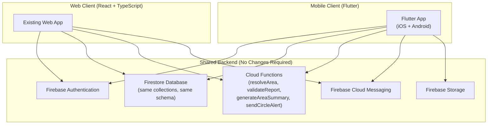

# Awarely — Flutter Migration Architecture

**Version:** 1.0.0  
**Date:** October 2026  
**Status:** Future Planning Document — Design Only

---

## Purpose

This document defines the architecture for migrating or extending Awarely from its current React/Web implementation to a native Flutter mobile application, while **sharing the same Firebase backend, Firestore data model, and Cloud Functions** without any schema migration.

The Flutter app will be a companion to the web app — not a replacement. Both platforms will coexist using the same Firebase project.

---

## Migration Strategy

### Principle: Backend Stays. Frontend Multiplies.

The Firebase backend (Firestore schema, Cloud Functions, Firebase Auth, Firebase Storage, FCM) is designed to be **platform-agnostic**. Flutter consumes the exact same services.



---

## What Stays the Same

| Component | Web | Flutter | Notes |
|---|---|---|---|
| Firestore collections | `areas`, `reports`, `users`, `trustedContacts`, `alertHistory` | Same | Zero schema changes required |
| Cloud Functions | All 4 callable functions | Same | Called via `firebase_functions` package |
| Firebase Auth | Google, Email, Anonymous | Same | Called via `firebase_auth` package |
| Firebase Storage | Photo uploads | Same | Called via `firebase_storage` package |
| FCM tokens | `platform: 'web'` | `platform: 'android' \| 'ios'` | Same `fcmTokens` array on user document |
| Observation tags | `OBSERVATION_TAGS` constant | Same vocabulary | Defined in shared reference |
| Area model | GeoJSON polygon, bounds | Same | Firestore document structure identical |
| Safety scoring logic | Cloud Function nightly | Same | Computed server-side, consumed by all clients |
| Gemini AI summaries | Cloud Function | Same | `area.aiSummary` consumed as-is |

---

## Flutter Package Equivalents

| Web Technology | Flutter Package | Notes |
|---|---|---|
| `firebase/auth` | `firebase_auth` | `^4.x` |
| `firebase/firestore` | `cloud_firestore` | `^4.x` |
| `firebase/storage` | `firebase_storage` | `^11.x` |
| `firebase/functions` | `cloud_functions` | `^4.x` |
| `firebase/messaging` | `firebase_messaging` | `^14.x` |
| `@vis.gl/react-google-maps` | `google_maps_flutter` | Official Google Maps Flutter plugin |
| `framer-motion` | Built-in Flutter animations + `animated_text_kit` | Native Flutter animation system |
| Lucide React | `flutter_svg` + custom SVG icons or `material_symbols_icons` | No direct equivalent; use Material 3 icons |
| React Context | `Provider` + `Riverpod` or `flutter_bloc` | Riverpod recommended for Flutter |
| Tailwind CSS | Flutter's widget styling system | No direct equivalent |
| `react-router` | `go_router` | Navigation 2.0 compatible |

---

## Firestore Data Model Compatibility

### All Firestore types map directly to Dart:

```dart
// Area model in Dart
class Area {
  final String id;
  final String name;
  final String city;
  final String country;
  final String fullName;
  final String? placeId;
  final AreaBounds bounds;
  final String polygon;
  final Timestamp createdAt;
  final Timestamp updatedAt;
  final bool isActive;
  // Aggregated metrics
  final int reportCount;
  final int recentReportCount;
  final Timestamp? latestReportAt;
  final List<String> topObservations;
  final DayNightSplit dayNightSplit;
  final String confidenceLevel;  // 'high' | 'moderate' | 'low'
  final String awarenessLevel;   // 'active' | 'mixed' | 'quiet' | 'unknown'
  final String? aiSummary;
  final Timestamp? aiSummaryGeneratedAt;

  factory Area.fromFirestore(DocumentSnapshot doc) {
    final data = doc.data() as Map<String, dynamic>;
    return Area(
      id: doc.id,
      name: data['name'] as String,
      city: data['city'] as String,
      country: data['country'] as String,
      fullName: data['fullName'] as String,
      placeId: data['placeId'] as String?,
      bounds: AreaBounds.fromMap(data['bounds'] as Map<String, dynamic>),
      polygon: data['polygon'] as String,
      createdAt: data['createdAt'] as Timestamp,
      updatedAt: data['updatedAt'] as Timestamp,
      isActive: data['isActive'] as bool,
      reportCount: data['reportCount'] as int,
      recentReportCount: data['recentReportCount'] as int,
      latestReportAt: data['latestReportAt'] as Timestamp?,
      topObservations: List<String>.from(data['topObservations'] ?? []),
      dayNightSplit: DayNightSplit.fromMap(data['dayNightSplit'] as Map<String, dynamic>),
      confidenceLevel: data['confidenceLevel'] as String,
      awarenessLevel: data['awarenessLevel'] as String,
      aiSummary: data['aiSummary'] as String?,
      aiSummaryGeneratedAt: data['aiSummaryGeneratedAt'] as Timestamp?,
    );
  }
}
```

---

## Authentication Architecture (Flutter)

### Firebase Auth in Flutter

```dart
// Authentication flows mirror the web implementation exactly

// Google Sign-In
final googleUser = await GoogleSignIn().signIn();
final googleAuth = await googleUser!.authentication;
final credential = GoogleAuthProvider.credential(
  accessToken: googleAuth.accessToken,
  idToken: googleAuth.idToken,
);
await FirebaseAuth.instance.signInWithCredential(credential);

// Email/Password
await FirebaseAuth.instance.signInWithEmailAndPassword(
  email: email,
  password: password,
);

// Anonymous (Guest)
await FirebaseAuth.instance.signInAnonymously();

// Session persistence — automatic in Flutter (Firebase persists auth state natively)
FirebaseAuth.instance.authStateChanges().listen((User? user) {
  // Equivalent to onAuthStateChanged in web
});
```

---

## FCM Integration (Flutter)

Flutter FCM tokens use `platform: 'android'` or `platform: 'ios'`, stored in the same `users/{uid}/fcmTokens` array that web uses with `platform: 'web'`.

```dart
// flutter/lib/services/notifications_service.dart

Future<void> initializeFCM(String uid) async {
  final messaging = FirebaseMessaging.instance;

  // Request permission (iOS requires explicit permission; Android auto-granted)
  await messaging.requestPermission();

  // Get FCM token
  final token = await messaging.getToken();
  if (token == null) return;

  // Store in Firestore — same schema as web
  final platform = Platform.isIOS ? 'ios' : 'android';
  await FirebaseFirestore.instance
      .collection('users')
      .doc(uid)
      .update({
        'fcmTokens': FieldValue.arrayUnion([{
          'token': token,
          'platform': platform,
          'updatedAt': FieldValue.serverTimestamp(),
        }]),
        'notificationsEnabled': true,
      });

  // Handle foreground messages
  FirebaseMessaging.onMessage.listen((RemoteMessage message) {
    // Show in-app notification
  });
}
```

---

## Area Resolution (Flutter)

The Flutter app calls the same `resolveArea` Cloud Function. Location is accessed via the `geolocator` package:

```dart
// flutter/lib/services/area_service.dart
import 'package:geolocator/geolocator.dart';
import 'package:cloud_functions/cloud_functions.dart';

Future<ResolveAreaResult?> resolveUserArea() async {
  // Check and request location permission
  final permission = await Geolocator.checkPermission();
  if (permission == LocationPermission.denied) {
    await Geolocator.requestPermission();
  }

  // Get single position (discrete, not continuous)
  final position = await Geolocator.getCurrentPosition(
    desiredAccuracy: LocationAccuracy.low,  // Deliberately low accuracy
  );

  // Truncate to 3 decimal places (privacy)
  final lat = (position.latitude * 1000).round() / 1000;
  final lng = (position.longitude * 1000).round() / 1000;

  // Call same Cloud Function as web
  final fn = FirebaseFunctions.instance.httpsCallable('resolveArea');
  final result = await fn.call({'lat': lat, 'lng': lng});
  
  if (result.data['found'] == true) {
    return ResolveAreaResult(
      areaId: result.data['areaId'],
      areaName: result.data['areaName'],
    );
  }
  return null;
}
```

### Privacy Note

- `LocationAccuracy.low` is used deliberately — Flutter maps to network-based location (~1km radius) rather than GPS precision.
- `Geolocator.getPositionStream()` (continuous tracking) is **never called** in the production app.

---

## Google Maps Integration (Flutter)

```dart
// flutter/lib/widgets/awarely_map.dart
import 'package:google_maps_flutter/google_maps_flutter.dart';

class AwarelyMap extends StatefulWidget {
  final List<Area> areas;
  final LatLng? userCoarseLocation;
  
  @override
  Widget build(BuildContext context) {
    return GoogleMap(
      initialCameraPosition: CameraPosition(
        target: userCoarseLocation ?? const LatLng(28.6139, 77.2090),
        zoom: 14,
      ),
      minMaxZoomPreference: const MinMaxZoomPreference(12, 16), // Same as web
      myLocationEnabled: false,       // Explicitly disabled — we use our own imprecise dot
      zoomControlsEnabled: false,
      mapToolbarEnabled: false,
      polygons: areas.map((area) => _buildAreaPolygon(area)).toSet(),
      circles: userCoarseLocation != null
          ? {_buildUserDot(userCoarseLocation!)}
          : {},
    );
  }

  Polygon _buildAreaPolygon(Area area) {
    // Parse GeoJSON polygon from area.polygon
    return Polygon(
      polygonId: PolygonId(area.id),
      points: _parseGeoJsonPolygon(area.polygon),
      fillColor: _getAwarenessColor(area.awarenessLevel).withOpacity(0.2),
      strokeColor: _getAwarenessColor(area.awarenessLevel),
      strokeWidth: 1,
      consumeTapEvents: true,
    );
  }

  Circle _buildUserDot(LatLng position) {
    return Circle(
      circleId: const CircleId('user_location'),
      center: position,
      radius: 150,               // Imprecise 150m circle — same as web
      fillColor: Colors.blue.withOpacity(0.2),
      strokeColor: Colors.blue,
      strokeWidth: 2,
    );
  }
}
```

---

## State Management (Flutter)

**Recommended: Riverpod 2.x**

Riverpod provides the Flutter equivalent of React's Context + useState pattern used in the web app:

```dart
// Equivalent of useAuth() hook
final authProvider = StreamProvider<User?>((ref) {
  return FirebaseAuth.instance.authStateChanges();
});

// Equivalent of useAreaData() hook
final areaProvider = StreamProvider.family<Area?, String>((ref, areaId) {
  return FirebaseFirestore.instance
      .collection('areas')
      .doc(areaId)
      .snapshots()
      .map((snap) => snap.exists ? Area.fromFirestore(snap) : null);
});

// Equivalent of useDiscreteLocation() hook
final resolvedAreaProvider = FutureProvider<ResolveAreaResult?>((ref) async {
  return AreaService.resolveUserArea();
});
```

---

## Navigation Architecture (Flutter)

Using `go_router`:

```
/                → MapScreen (equivalent of MapPage)
/login           → LoginScreen
/onboard         → OnboardingScreen
/area/:areaId    → AreaDetailSheet (bottom sheet equivalent)
/profile         → ProfileScreen
/contacts        → TrustedCircleScreen
/report/:areaId  → FeedbackScreen
```

---

## Native Features Available in Flutter (Not in Web)

Flutter unlocks capabilities not available or limited on the web:

| Feature | Web (Current) | Flutter |
|---|---|---|
| Background FCM notifications | Limited (requires service worker) | ✅ Full background push support |
| App badge count | Not supported | ✅ Available (iOS/Android) |
| Persistent local storage | `localStorage` / `IndexedDB` | ✅ `shared_preferences` / `hive` |
| Offline Firestore | Limited | ✅ Full offline persistence built-in |
| Native share sheet | Web Share API (limited) | ✅ `share_plus` package |
| Biometric authentication | Not available | ✅ `local_auth` package |
| Deep links (area sharing) | Limited | ✅ Firebase Dynamic Links / App Links |
| Haptic feedback | Limited | ✅ `HapticFeedback` |
| Background location (future) | Prohibited | ⚠️ Available but must be opt-in with explicit consent |

---

## Migration Phases

### Phase 1: Backend Stabilization (Current — Web Prototype)
- Complete web prototype on Firebase.
- Finalize and test all Cloud Functions.
- Validate Firestore schema against real usage.
- Ensure FCM token storage schema is working for `platform: 'web'`.
- Document all API contracts (done in `api-contracts.md`).

### Phase 2: Flutter Shell (Parallel Development)
- Initialize Flutter project in `flutter/` directory (sibling to web `src/`).
- Implement Firebase initialization with same project credentials.
- Implement Firebase Auth flows (Google + Email + Anonymous).
- Connect to existing Firestore and verify area data reads.

### Phase 3: Core Flutter Feature Parity
- Implement Google Maps integration with polygon overlays.
- Implement area resolution using same `resolveArea` Cloud Function.
- Implement `FeedbackModal` equivalent.
- Implement `TrustedCircleScreen`.
- Implement FCM push notifications for Android and iOS.

### Phase 4: Native Enhancement
- Add offline Firestore persistence.
- Add haptic feedback on zone entry.
- Add app background FCM (full push delivery).
- Add native share functionality for area awareness.

### Phase 5: Platform Feature Divergence (If Required)
- Web: PWA improvements, browser notifications, keyboard navigation.
- Flutter: Deep links, biometric auth, widget overlays.

---

## Project Repository Structure (Recommended)

```
awarely/
├── src/                           ← Web app (React + TypeScript)
│   └── [web source tree]
├── flutter/                       ← Flutter app
│   ├── lib/
│   │   ├── main.dart
│   │   ├── models/
│   │   ├── providers/
│   │   ├── screens/
│   │   ├── widgets/
│   │   └── services/
│   ├── android/
│   ├── ios/
│   └── pubspec.yaml
├── functions/                     ← Shared Cloud Functions (TypeScript)
│   └── [functions source tree]
├── docs/                          ← Architecture documents
│   ├── architecture.md
│   ├── database-schema.md
│   ├── api-contracts.md
│   ├── privacy-model.md
│   └── flutter-migration.md
├── firebase.json
├── firestore.rules
├── firestore.indexes.json
├── storage.rules
└── .firebaserc
```

---

## Checklist: Ensuring Web→Flutter Backend Compatibility

Before starting Flutter development, verify:

- [ ] All Cloud Functions are callable via `FirebaseFunctions.instance.httpsCallable()`
- [ ] Firestore Security Rules work with Firebase Auth tokens from Flutter SDK
- [ ] FCM token schema includes `platform` field that accepts `'android'` and `'ios'`
- [ ] GeoJSON polygon format in Firestore is parseable by Dart's JSON decoder
- [ ] All `Timestamp` fields are Firestore native Timestamps (not ISO strings)
- [ ] All `GeoPoint` fields use Firestore native GeoPoints (not `{lat, lng}` maps)
- [ ] Firebase Storage rules allow authenticated reads for report photos
- [ ] Firestore indexes support Flutter query patterns (collection group queries)
- [ ] Admin SDK functions (Cloud Functions) are not dependent on web-specific APIs
